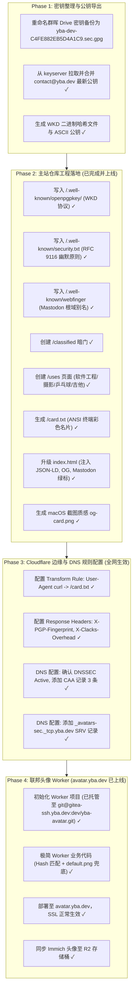

# yba.dev 极客身份基础设施与主站升级实施计划

> [!NOTE]
> 本方案严格遵循“**对外基线完全收敛、与私有 Homelab 彻底解耦、表面极简/底层硬核、兼顾协议标准与人类真实趣味**”的总体原则。

---

## 一、前期疑问解答与技术审计结果

### 1. 关于 `/colophon` 的决断：确认彻底舍弃
* 经过实测，过去很多网站的 `/colophon` 均已 404 下线，说明该概念在现代网络中确已极度边缘化，不再具备鲜活的社区生态。
* **决断**：**彻底不做 `/colophon`**。
* **保留最实用、鲜活的 `/uses`**：`/uses`（源自 [uses.tech](https://uses.tech/)）目前有超过 2000+ 顶尖活跃工程师持续更新，包含真实工具、硬件与爱好，既硬核又接地气。

### 2. 邮件防伪状态审计（实测已配置完成）
通过终端对 `yba.dev` 进行实际 DNS 探测：
* **SPF**：`v=spf1 include:_spf.protonmail.ch ~all`（已生效）
* **DMARC**：`v=DMARC1;p=quarantine;`（已生效）
* **MX**：已绑定 ProtonMail 高优先级节点 `mail.protonmail.ch`
> [!TIP]
> 邮件权威防伪已在昨天配置妥当，不需要重复操作，直接保持现状。

### 3. CAA（证书颁发机构授权）是什么原理？
* **背景风险**：全球有上百家被操作系统和浏览器信任的受信任 CA（如 DigiCert, Let's Encrypt, Sectigo, GoDaddy 等）。历史上曾发生过小 CA 被黑客入侵或遭遇 BGP 劫持，黑客诱骗某个未知名 CA 违规为他人域名签发伪造证书的事件。
* **CAA 原理（RFC 8659）**：在 DNS 明确声明：*“全球所有 CA 听好，只有本记录指定的机构允许为 `yba.dev` 签发证书，其他任何人找你们签发，一律拒绝并触发报警！”*
* **配置示例**：
  * `0 issue "letsencrypt.org"`
  * `0 issue "google.com"`
  * `0 iodef "mailto:contact@yba.dev"`（若有未经授权的申请，CA 会给你的邮箱发送违规告警）

---

## 二、`/uses` 页面内容架构定制

按照你的规划，聚焦以下核心领域，突出工程师的技术追求与真实的个人生活：

```
/uses
├── 01. Software Engineering & Systems（软件工程与系统）
│   ├── 开发与系统环境（Windows 11 + WSL2 深度工作流、Linux 发行版体验）
│   ├── 语言与核心技术栈（Rust、C/C++、Python、TypeScript，兼顾底层驱动与高并发）
│   ├── 工程思考与工具流（终端配置、dotfiles 哲学、Git 规范）
│   └── 密码学与安全硬件（FIDO2 U2F 硬件密钥、GnuPG C4FE882EB5D4A1C9、1Password）
│
├── 02. Photography & Optics（摄影与光学）
│   ├── 机身与光学镜头（Leica 摄影系统、光学直觉与色彩把控）
│   └── 后期流程与数字暗房（Retouch4me AI 插件、Lightroom 工作流）
│
├── 03. Table Tennis & Sports（乒乓球竞技）
│   ├── 底板与胶皮配置（正反手器材搭配与击球手感选择）
│   └── 竞技与联赛（OzPong 战绩与竞技日常）
│
└── 04. Music & Others（音乐与在途爱好）
    └── 木吉他（民谣弹唱与练习，大横按能按出来，目前主要在持续打磨基础指法与节奏感）
```

---

## 三、`security.txt` 严肃且幽默的原则设计（RFC 9116）

在 `/.well-known/security.txt` 的披露政策中，写入极客圈最地道、既专业又幽默的原则：

```txt
Contact: mailto:contact@yba.dev
Encryption: https://yba.dev/.well-known/openpgpkey/hu/dj3498u4hyyarh35rkjfnghbjxug6b19?l=contact
Preferred-Languages: en, zh
Canonical: https://yba.dev/.well-known/security.txt
Expires: 2038-05-27T00:00:00.000Z

# Security Principles & Bounty Policy:
# 1. This is a static site served via GitHub Pages behind Cloudflare CDN. 
#    Running automated vulnerability scanners (Acunetix, Nessus, SQLMap) 
#    at 5,000 req/s will only benchmark Cloudflare's WAF and burn your own CPU.
# 2. No social engineering attacks against the author, friends, or pets.
# 3. Denial of Service (DoS/DDoS) is not a vulnerability; it just means you bought more bandwidth than me.
# 4. Bounty: PGP-signed sincere gratitude, a public mention, and a cup of specialty coffee 
#    (or craft beer) if you happen to be in the same city. No cash bounties.
# 5. Please encrypt all vulnerability reports using the PGP key above. 
#    Unencrypted disclosures will deduct 50 AI credits (or your monthly GPU quota).
```


---

## 四、`/classified` 暗门设计

在 `robots.txt` 中写入：
```txt
User-agent: *
Disallow: /.well-known/
Disallow: /classified
```
在 `/classified` 页面呈现极简单色终端纯文本：
* 一个冷峻的 ASCII Art 字符画。
* 一段对好奇心与探索精神的致敬文字。
* PGP 清单指纹验证。

---

## 五、机器语义化与社交卡片（JSON-LD & Open Graph）

在 HTML `<head>` 中嵌入深层元数据：
1. **JSON-LD Schema (`Person`)**：
   * 关联 `sameAs`：GitHub、Mastodon、PGP 公钥服务器、LinkedIn、摄影站点。
   * 声明个人公开代表作（`clash-rs`、`SoftU2F-Win`）。
2. **Open Graph & Twitter Card**：
   * `og:title`: "Yuwei Ba — yba.dev"
   * `og:type`: "profile"
   * `og:description`: "Software engineer, systems & security enthusiast, photographer."
   * `og:image`: 一张专属的高对比度纯黑底色、等宽字符排版的极客终端风格名片预览图，在社交平台分享时自动展开。

---

## 六、总体推进实施路线图（4 个 Phase）



---

## 六、交付总结与服务状态

| 模块 / 服务 | 线上端点 / 资产 | 状态 | 验证方式 |
| :--- | :--- | :--- | :--- |
| **主页与名片** | `https://yba.dev` | 活跃 | 浏览器正常打开主站；终端 `curl yba.dev` 返回 ANSI 名片 |
| **WKD 公钥发现** | `https://yba.dev/.well-known/openpgpkey/...` | 活跃 | `gpg --locate-keys contact@yba.dev` 毫秒拉取公钥 |
| **安全准则** | `https://yba.dev/.well-known/security.txt` | 活跃 | 符合 RFC 9116，支持 2038 永不过期原则 |
| **WebFinger 别名** | `https://yba.dev/.well-known/webfinger?resource=...` | 活跃 | Mastodon 联邦协议解析 `@yba@yba.dev` 直达账号 |
| **装备清单** | `https://yba.dev/uses` | 活跃 | 定制化系统、光学设备与线下运动 |
| **终端暗门** | `https://yba.dev/classified` | 活跃 | 普拉切特极客终端彩蛋，搜索引擎已 Disallow |
| **响应头信标** | `X-Clacks-Overhead`, `X-PGP-Fingerprint` | 活跃 | `curl -sI https://yba.dev/` 全局附带 |
| **DNS CAA 限制** | `yba.dev` CAA 记录 | 活跃 | `dig @1.1.1.1 CAA yba.dev +short` 锁定 Let's Encrypt / Google Trust |
| **Libravatar 发现** | `_avatars-sec._tcp.yba.dev` SRV 记录 | 活跃 | `dig @1.1.1.1 SRV _avatars-sec._tcp.yba.dev +short` 解析至 `avatar.yba.dev:443` |
| **联合头像服务** | `https://avatar.yba.dev/` | 活跃 | 支持 Gravatar(MD5) 与 Libravatar(SHA256)，真实 Immich 头像返回 200 |
| **Worker 源码托管** | `git@gitea-ssh.yba.dev:dev/yba-avatar.git` | 已归档 | master 分支推送到内网 Gitea 仓库 |

